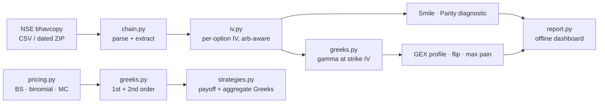

# GreeksLab


**A derivatives pricing & options-analytics engine that works on real exchange data — and shows you where the data itself is lying.**

Black-Scholes-Merton, binomial and Monte Carlo pricers that cross-check each other; analytic Greeks through the second order (vanna, charm, vomma), each validated against finite differences; an arbitrage-aware implied-vol solver; and a full NSE option-chain toolkit (IV smile, dealer gamma exposure, gamma flip, max pain — plus a put-call-parity diagnostic that measures settlement-print quality instead of hiding it).

> **Headline, from the real NIFTY chain of 3 Nov 2026** (full study in [docs/CASES.md](docs/CASES.md)):
> ATM IV **10.8% CE / 19.9% PE** (the gap is a measured parity break: implied forward 23,690 vs spot 23,811) · 5%-OTM put IV **24.4%** vs equidistant call **17.6%** · dealer gamma flip at **23,872** — 61 points above spot · max pain **23,600** · and the rolling ATM straddle bled **−149.15 points (−28.5%, ₹9,695/lot) in five sessions** while spot *rallied* +1,112 points.

## Quickstart

```bash
pip install -r requirements.txt        # numpy, pandas, scipy (+ pytest for tests)
python main.py                         # three pricers cross-check + real-chain analytics
python -m pytest tests -q              # 47 tests
```

Open `docs/dashboard.html` — a self-contained dark dashboard (IV smile + GEX-by-strike from the real 3 Nov 2026 chain, works offline, no CDN).

The repo ships a small extracted sample chain (`data/sample_nifty_chain.csv`, 22 KB) so everything runs offline. `tools/build_sample.py` regenerates it — and every case-study number — from the full 220-day bhavcopy archive if you have it.

## What's inside

| Module | Contents |
|---|---|
| `src/greekslab/pricing.py` | BSM (with dividend yield), CRR binomial (European **and American** early exercise), Monte Carlo with antithetic variates + standard error |
| `src/greekslab/greeks.py` | Delta, gamma, theta, vega, rho + **vanna, charm, vomma** — analytic, with a bump-and-reprice validation harness for every one |
| `src/greekslab/iv.py` | Implied vol: Newton with a bisection fallback; prices below the no-arbitrage bound return NaN, never a fantasy IV |
| `src/greekslab/chain.py` | NSE bhavcopy parser (CSV or dated ZIP), chain extraction, OTM smile, **parity diagnostics**, GEX profile, gamma flip, max pain, cross-day straddle tracker |
| `src/greekslab/strategies.py` | Straddle, strangle, iron condor, vertical spreads: expiry payoff, aggregate Greeks, max P/L, breakevens |
| `src/greekslab/report.py` | Self-contained HTML dashboard generator (inline SVG) |
| `docs/CASES.md` | Three case studies on real data (below) |
| `tests/` | 47 tests: put-call parity, binomial→BS convergence, MC within 3 SE of BS, every Greek vs finite differences (incl. vanna/charm/vomma, ATM and OTM), IV round-trips, real-chain invariants, strategy payoff identities |

## The maths

With $d_1 = \frac{\ln(S/K) + (r-q+\sigma^2/2)T}{\sigma\sqrt{T}}$, $d_2 = d_1 - \sigma\sqrt{T}$, $\varphi$ the normal pdf:

| Greek | Formula | Units here |
|---|---|---|
| Delta (call) | $e^{-qT} N(d_1)$ | per 1.00 spot |
| Gamma | $e^{-qT}\varphi(d_1)/(S\sigma\sqrt{T})$ | per 1.00 spot |
| Theta (call) | $-\frac{S e^{-qT}\varphi(d_1)\sigma}{2\sqrt{T}} - rKe^{-rT}N(d_2) + qSe^{-qT}N(d_1)$ | per calendar day (÷365) |
| Vega | $S e^{-qT}\varphi(d_1)\sqrt{T}$ | per 1 vol point (÷100) |
| Rho (call) | $KTe^{-rT}N(d_2)$ | per 1 rate point (÷100) |
| Vanna | $-e^{-qT}\varphi(d_1)\, d_2/\sigma$ | dΔ/dσ |
| Vomma | $\text{Vega}_{raw}\, d_1 d_2/\sigma$ | dVega/dσ |
| Charm | $-\partial\Delta/\partial T$, derived exactly via $\partial d_1/\partial T$ (see code) | delta decay per day |

**Three pricers, one truth:** the CLI prices the same ATM call at BS **171.20**, binomial (800 steps) **171.15**, Monte Carlo (400k antithetic paths) **170.96 ± 0.27 SE** — agreement inside one standard error, enforced by tests (binomial convergence, MC within 3 SE).

**GEX convention:** per strike, $GEX_K = (\Gamma^{CE}_K OI^{CE}_K - \Gamma^{PE}_K OI^{PE}_K) \times LOT \times S^2 \times 0.01$ in ₹ per 1% move, OI in contracts. (The US literature's ×100 is the SPX contract multiplier; NIFTY's lot — 65, read from the file — plays that role.) Gamma at each strike's own IV, ATM-IV fallback where a strike's IV does not solve.

## Architecture



## Case studies (docs/CASES.md)

- **Case A — a real chain, taken apart.** The 3 Nov 2026 NIFTY smile (steep downside skew: −10% wing at 36.4%), a measured put-call-parity break in the settlement prints (implied forward −121 pts, residual sd 155 pts; 100% of OTM IVs solve, 58% of ITM prints sit below the no-arb bound), dealer GEX +₹12,619 crore with the flip 61 points above spot, max pain at 23,600.
- **Case B — theta bleed, measured.** The rolling ATM straddle of the 9 Nov expiry lost 149.15 points (−28.5%, ₹9,695/lot) across 28 Oct → 3 Nov 2026 while spot rallied +4.9% — five real days of bhavcopy, ≈ ₹1,940/lot/day of decay.
- **Case C — why directional option buying died on real premiums.** A documented 60-day real-premium re-test of ORB / 5-EMA / Order Block systems: all six runs PF < 0.9 — explained Greek by Greek (delta ≠ 1, theta tax, vega crush, settlement ≠ tradable) with a transferable 2× hurdle rule.

## Limitations — read before trusting any number

- **Settlement/close prints are not tradable prices.** `ClsPric` on illiquid strikes can be stale or model-marked; Case A measures the resulting parity deviation on this very file. IVs are therefore built from OTM options, and bound-violating prints yield NaN by design.
- **GEX is a positioning model, not an observation.** It assumes dealers are short the open interest and hedges are gamma-driven; treat flip levels as regime hints, not magnets.
- **q = 0, r = 6.5%, actual/365** are stated conventions, not market truths; the parity diagnostic exists precisely because index forwards embed carry the spot-based model omits.
- Index options only in the chain tools (the pricers are general). No live feed — bhavcopy is end-of-day by construction.

## License & disclaimer

MIT. Educational research software — **not investment advice**. Market data © NSE; the bundled sample is a small extract for reproducibility.
